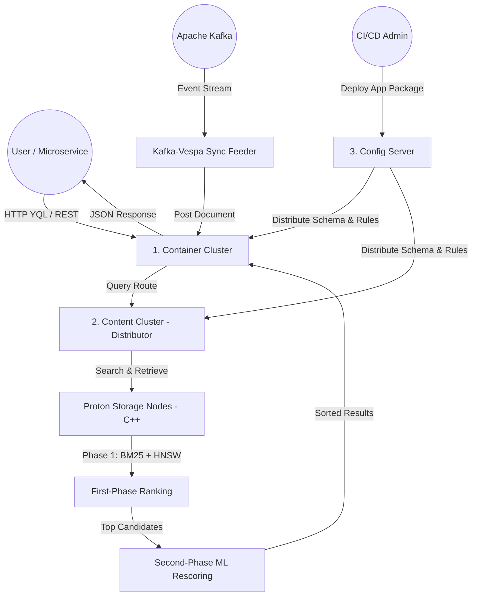

# 🚀 Vespa.ai Industrial-Strength Distributed Big Data & Search Engine Platform

[](https://vespa.ai)
[](https://golang.org)
[](https://www.python.org)
[](https://kafka.apache.org)
[](LICENSE)

Este diretório contém a especificação arquitetural, infraestrutura em container e implementação de referência para um ecossistema industrial de busca vetorial, processamento e servimento de Big Data orientado a IA utilizando o **Vespa.ai**. A plataforma combina busca híbrida (BM25 + HNSW ANN Vectors), ranking em duas fases (Multi-Phase Ranking) e ingestão contínua em tempo real integrada ao Apache Kafka e microsserviços Golang.

---

## 🏛️ 1. Arquitetura do Sistema Vespa.ai

O Vespa é um sistema distribuído composto por clusters altamente especializados que se comunicam via protocolo proprietário de baixa latência (**MessageBus**) e um plano centralizado de gerenciamento de configurações (**Config Server**).

```text
                                  +-----------------------+
                                  |   USUÁRIO / APLICAÇÃO  |
                                  +-----------+-----------+
                                              |
                                     HTTP/REST| (Port 8080)
                                              v
      +-------------------------------------------------------------------------------+
      | 1. CONTAINER CLUSTER (Query & Write API Layer)                                |
      |  - Stateless & Horizontally Scalable                                         |
      |  - Search & DocProc Chains (Modular pipelines)                                |
      |  - Handles YQL Query Parsing, Business Logic, and Document Processing         |
      +---------------------------------------+---------------------------------------+
                                              |
                                 MessageBus   | (Internal Protocol)
                                              v
      +-------------------------------------------------------------------------------+
      | 2. CONTENT CLUSTER (Data, Indexing & Ranking Engine)                          |
      |                                                                               |
      |   +-----------------------------------------------------------------------+   |
      |   | DISTRIBUTORS                                                          |   |
      |   |  - Entrypoint for Put/Update/Remove operations                         |   |
      |   |  - Consistent Hashing mapping Document IDs -> Storage Nodes           |   |
      |   +-----------------------------------+-----------------------------------+   |
      |                                       |                                       |
      |                                       v                                       |
      |   +-----------------------------------------------------------------------+   |
      |   | STORAGE NODES (Proton Engine - C++)                                   |   |
      |   |  - Inverted Text Index (BM25)                                         |   |
      |   |  - Vector Index (HNSW Graphs for ANN)                                 |   |
      |   |  - Multi-Phase Ranking Engine (1st Phase Heuristics + 2nd Phase ML)  |   |
      |   +-----------------------------------------------------------------------+   |
      +-------------------------------------------------------------------------------+
                                              ^
                                              | Config Push
      +---------------------------------------+---------------------------------------+
      | 3. MANAGEMENT & CONTROL PLANE                                                 |
      |  - Config Server: Single source of truth (Application Package deployment)     |
      |  - Cluster Controller: Health monitoring, failover, and data replication      |
      +-------------------------------------------------------------------------------+
```

### Diagrama de Fluxo de Dados (Mermaid)



---

## 🧩 2. Principais Clusters Funcionais

### 1. The Container Cluster (Query & Write API)
- **Função:** Camada de aplicação stateless responsável por receber tráfego HTTP/REST externo, parsear consultas YQL, executar regras de negócio e reescrever documentos através de pipelines modulares (**DocProc Chains**).
- **Escalabilidade:** Como os nós de container não possuem estado persistente, podem ser escalados horizontalmente por trás de Load Balancers HTTP para responder a picos imensos de tráfego.

### 2. The Content Cluster (Data, Indexing & Ranking - Proton Engine)
- **Distributor:** Ponto de entrada para operações de gravação (`put`, `update`, `remove`). Mantém o mapeamento de ID de documentos para nós de armazenamento físicos através de algoritmos de hashing consistente.
- **Storage Node (Proton Engine):** Núcleo de armazenamento de altíssima performance escrito em C++.
  - **Indexing:** Gerencia índices invertidos de texto com pontuação BM25 e grafos HNSW (*Hierarchical Navigable Small World*) para busca vetorial aproximada (ANN).
  - **Ranking Framework (Multi-Phase Ranking):**
    - *Primeira Fase:* Avaliação heurística ultrarrápida (BM25 + vetores) em massa sobre milhões de candidatos.
    - *Segunda Fase:* Re-ranqueamento pesado (modelos ML/ONNX/Expressões matemáticas) aplicado exclusivamente ao top-*k* candidatos pré-selecionados.

### 3. The Management & Control Plane
- **Config Server:** Fonte única da verdade. Mantém o **Application Package** (`services.xml` e esquemas `.sd`) e distribui atualizações de estado e configuração para todos os nós ativamente.
- **Cluster Controller:** Monitora o estado de integridade (*healthcheck*) dos nós de conteúdo, acionando replicação automática e failover sem interrupção de serviço.

---

## 🛠️ 3. Infraestrutura em Container e Instalação

A infraestrutura completa é gerenciada via Docker Compose.

### Estrutura de Arquivos da Stack
```text
vespa-search-engine/
├── app/
│   ├── services.xml           # Configuração de Clusters e Serviços Vespa
│   └── schemas/
│       ├── article.sd         # Esquema, Campos, Índices HNSW e Ranking Profiles
│       └── item.sd            # Esquema Item com busca por texto e vetores Euclidean
├── go-orchestrator/
│   ├── go.mod                 # Módulo Go 1.24
│   ├── broker.go              # Broker de Server-Sent Events (SSE)
│   ├── indexer.go             # Worker de Ingestão Kafka -> Vespa Document API
│   ├── client.go              # Cliente REST Vespa & Construtor YQL
│   ├── main.go                # API Gateway do Orquestrador e SSE Endpoint
│   └── *_test.go              # Testes de Unidade Go (Client, Broker, Indexer)
├── nextjs-frontend/           # Aplicação Next.js App Router (Direct Search & Live SSE)
│   ├── app/actions.ts         # Server Action para busca direta no Vespa via HTTP
│   └── app/components/        # Componente React para escutar eventos SSE em tempo real
├── kafka-feeder/
│   └── feeder.py              # Sincronizador de Eventos Kafka -> Vespa REST
├── tests/
│   └── validate_vespa_app.py  # Harness de Validação de Configuração e Esquemas
├── docker-compose.yml         # Orquestração Multi-Container
└── README.md                  # Documentação Completa da Plataforma
```

### Inicialização da Stack Local
```bash
# Navegue até o diretório do projeto
cd vespa-search-engine

# Suba a infraestrutura em segundo plano
docker compose up -d
```

### Portas Mapeadas:
- **Container Cluster HTTP API:** `http://localhost:8080` (Consultas YQL e Document API)
- **Config Server API:** `http://localhost:19071` (Deploy de pacotes de aplicação)
- **Golang Orchestrator REST API & SSE Broker:** `http://localhost:8090` (`/api/v1/articles` e `/events`)
- **Kafka Broker:** `localhost:9092` / `localhost:29092`

---

## ⚙️ 4. Configuração do Pacote de Aplicação (Application Package)

### A. Configuração de Serviços (`app/services.xml`)
Define a topologia dos clusters Container e Content:

```xml
<?xml version="1.0" encoding="utf-8" ?>
<services version="1.0">
  <container id="default" version="1.0">
    <document-api />
    <search />
    <nodes><node hostalias="node1" /></nodes>
  </container>

  <content id="content" version="1.0">
    <redundancy>1</redundancy>
    <documents>
      <document type="article" mode="index" />
      <document type="item" mode="index" />
    </documents>
    <nodes><node hostalias="node1" distribution-key="0" /></nodes>
    <engine><proton /></engine>
  </content>
</services>
```

### B. Esquema do Documento (`app/schemas/article.sd`)
Especifica o modelo de dados, índices HNSW e perfis de ranking em duas fases:

```schema
schema article {
    document article {
        field id type string { indexing: summary | attribute }
        field title type string { indexing: summary | index; index: enable-bm25 }
        field body type string { indexing: summary | index; index: enable-bm25 }
        field category type string { indexing: summary | attribute }
        field embedding type tensor<float>(x[384]) {
            indexing: summary | attribute | index
            index { distance-metric: angular }
        }
        field popularity type float { indexing: summary | attribute }
        field timestamp type long { indexing: summary | attribute }
    }

    rank-profile hybrid-multi-phase {
        inputs {
            query(q_embedding) tensor<float>(x[384])
        }

        # Primeira Fase: Heurística ultrarrápida
        first-phase {
            expression: bm25(title) * 0.4 + bm25(body) * 0.3 + closeness(field, embedding) * 0.3
        }

        # Segunda Fase: Re-ranqueamento pesado no top-100
        second-phase {
            expression: firstPhase + attribute(popularity) * 0.1
        }

        rerank-count: 100
    }
}
```

---

## 💻 5. Execução e Uso

### A. Deploy do Application Package via cURL
```bash
# Prepara arquivo zip do pacote de aplicação
cd vespa-search-engine/app && zip -r ../app.zip . && cd ..

# Envia o pacote de aplicação para o Config Server do Vespa
curl --header "Content-Type: application/zip" \
     --data-binary @app.zip \
     http://localhost:19071/application/v2/tenant/default/session

# Ativa a sessão enviada
curl -X PUT http://localhost:19071/application/v2/tenant/default/session/1/prepared
curl -X PUT http://localhost:19071/application/v2/tenant/default/session/1/active
```

### B. Ingestão de Documento via API REST
```bash
curl -X POST -H "Content-Type: application/json" \
     -d '{
       "fields": {
         "id": "doc-1001",
         "title": "Arquitetura Distribuída do Vespa.ai",
         "body": "O Proton Engine utiliza índices HNSW para busca vetorial de baixa latência.",
         "category": "tecnologia",
         "popularity": 9.5,
         "timestamp": 1700000000
       }
     }' \
     http://localhost:8080/document/v1/article/article/docid/doc-1001
```

### C. Consulta Híbrida em YQL via Golang Orchestrator
```bash
curl "http://localhost:8090/api/v1/articles?q=Vespa+Proton&category=tecnologia"
```

---

## 🔄 6. Integrando Vespa.ai em Stream em Tempo Real via Kafka e SSE (Arquitetura Fechada)

Integrar o Vespa.ai a este fluxo de streaming em tempo real via Kafka e Server-Sent Events (SSE) completa a arquitetura em ciclo fechado (*closed-loop*).
Nesta topologia, o Vespa atua como o banco de dados de busca e vetores indexado assincronamente via Kafka, e quando ocorrem alterações, notificações são transmitidas (*broadcast*) através do Broker SSE em Go para o frontend em Next.js.

### Fluxo de Integração Full-Stack

```text
[ Next.js Frontend ]
        │ (1. User Search / Actions)
        ▼
[ Golang Backend ] ──(2. Produces Event)──► [ Apache Kafka ]
        ▲                                          │
        │ (5. SSE Live Update)                     ▼
        └─────────────────────────────── [ Kafka Consumer / Vespa Feeder ]
                                                   │
                                                   ▼
                                           [ Vespa.ai Engine ]
                                                   │
        ┌──────────────────────────────────────────┘
        ▼ (3. Direct Search / Vector Query via HTTP/2)
[ Next.js Server Components ]
```

### Guia de Integração Passo a Passo

#### Passo 1: Definição do Esquema Vespa (`app/schemas/item.sd`)
Defina a estrutura dos dados indexados no Vespa (por exemplo, itens pesquisáveis contendo texto e vetores para busca por IA):

```schema
schema item {
    document item {
        field id type string {
            indexing: summary | attribute
        }
        field title type string {
            indexing: summary | index
            bolding: on
        }
        field embedding type tensor<float>(x[384]) {
            indexing: summary | attribute
            attribute {
                distance-metric: euclidean
            }
        }
    }

    fieldset default {
        fields: title
    }
}
```

#### Passo 2: Worker de Ingestão Kafka-para-Vespa e Broker SSE (Go)
Construa o consumidor Kafka que consome mensagens do tópico e grava diretamente na Feed API de alta performance do Vespa (usando o formato HTTP/2 JSON Feed) transmitindo notificações SSE em tempo real:

```go
package main

import (
    "bytes"
    "context"
    "fmt"
    "net/http"
    "time"

    "github.com/segmentio/kafka-go"
)

func StartVespaIndexer(brokerAddress, topic string, broker *Broker) {
    r := kafka.NewReader(kafka.ReaderConfig{
        Brokers:  []string{brokerAddress},
        Topic:    topic,
        GroupID:  "vespa-index-worker",
    })

    client := &http.Client{Timeout: 10 * time.Second}

    for {
        m, err := r.ReadMessage(context.Background())
        if err != nil {
            break
        }

        // 1. Transform Kafka message to Vespa JSON Feed format
        vespaDocumentURL := fmt.Sprintf("http://localhost:8080/document/v1/namespace/item/docid/%s", string(m.Key))

        // Example payload matching your Vespa schema
        vespaPayload := []byte(fmt.Sprintf(`{"fields": {"title": "%s"}}`, string(m.Value)))

        req, _ := http.NewRequest("PUT", vespaDocumentURL, bytes.NewBuffer(vespaPayload))
        req.Header.Set("Content-Type", "application/json")

        // 2. Send to Vespa
        resp, err := client.Do(req)
        if err != nil {
            continue
        }
        resp.Body.Close()

        // 3. Broadcast real-time update to Next.js clients via SSE Broker
        notification := fmt.Sprintf(`{"status": "indexed", "id": "%s"}`, string(m.Key))
        broker.Notifier <- []byte(notification)
    }
}
```

#### Passo 3: Consultando o Vespa Diretamente a partir do Next.js
Enquanto as gravações passam pelo Kafka, o frontend Next.js ou Server Actions consultam o Vespa diretamente com latência ultrabaixa para resultados de busca e similaridades vetoriais:

```typescript
// app/actions.ts
'use server';

export async function searchVespa(queryTerm: string) {
  const vespaQueryUrl = `http://localhost:8080/search/?yql=select * from sources * where default contains "${queryTerm}";`;

  const response = await fetch(vespaQueryUrl, {
    method: 'GET',
    cache: 'no-store',
  });

  if (!response.ok) {
    throw new Error('Failed to fetch from Vespa');
  }

  const data = await response.json();
  return data.root.children || [];
}
```

---

## 🧪 7. Testes Automatizados

A suíte de testes contempla testes unitários em Go para o cliente/construtor YQL, Broker SSE e Worker de Ingestão Kafka, além de uma harness em Python para validação estrutural do pacote Vespa.

### Executando os Testes em Go
```bash
cd vespa-search-engine/go-orchestrator
go test -v ./...
```

### Executando o Validador de Esquemas e Configuração
```bash
python3 vespa-search-engine/tests/validate_vespa_app.py
```

---

## 🛡️ 8. Segurança e Melhores Práticas de Produção

1. **Containers Stateless:** A camada de containers (`container cluster`) deve ser mantida estritamente sem estado persistente, permitindo auto-scaling horizontal reativo a métricas de CPU/latência.
2. **Dimensionamento de Memória Off-Heap para Proton:** O mecanismo Proton utiliza memória nativa C++ off-heap para carregar grafos HNSW. Garanta que o limite do container Docker permita folga além da JVM do Java.
3. **Isolamento de Réplicas:** Em clusters produtivos, configure a propriedade `<redundancy>2</redundancy>` ou superior no `services.xml` para garantir alta disponibilidade contra falhas de nós de conteúdo.

---

## 🔍 9. Troubleshooting e Diagnóstico

### Diagnóstico de Saúde do Cluster
```bash
# Verifica o status dos serviços gerenciados pelo Config Server
curl -s http://localhost:19071/state/v1/health

# Verifica o estado do nó de conteúdo
curl -s http://localhost:8080/state/v1/health
```

### Problemas Frequentes:
- **`Connection Refused` na porta 8080:** O nó do Vespa ainda está em processo de inicialização e subindo os serviços JVM/Proton. Aguarde o healthcheck do container retornar status `up`.
- **`Invalid YQL Syntax`:** Certifique-se de que as aspas internas em strings foram devidamente escapadas para `\"` ao formatar consultas dinâmicas no cliente Go.
